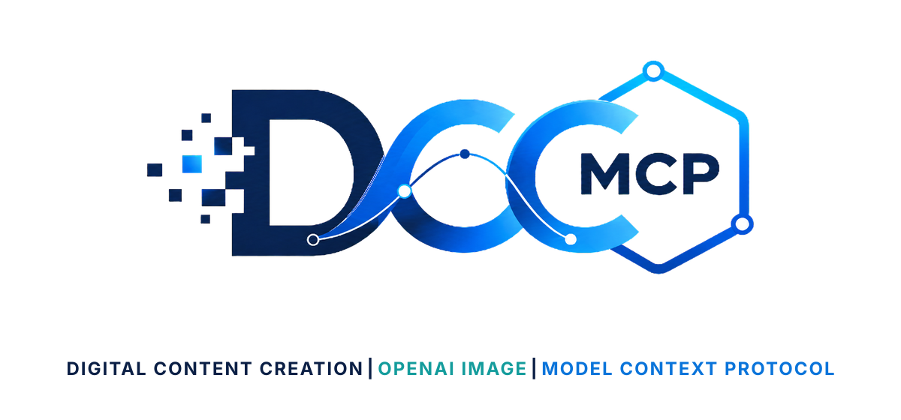
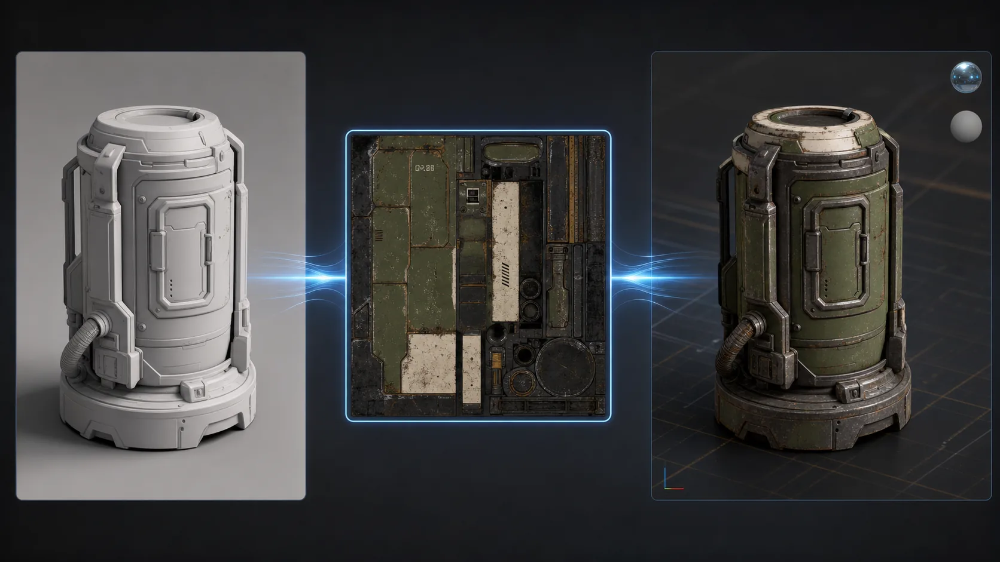

# dcc-ai-openai-image

<p align="center">
  
</p>

## Agent workflow

AI agents should use installed package skills through the shared gateway. IDE
users may continue to use the MCP endpoint.

### Install or update the CLI

`dcc-mcp-cli` is the preferred control path for every shell-capable agent. If
it is missing, ask the user before installing the latest official release:

On Linux/macOS, download and inspect the installer:

```bash
curl -fL https://raw.githubusercontent.com/dcc-mcp/dcc-mcp-core/main/scripts/install-cli.sh -o install-cli.sh
cat install-cli.sh
```

After completing the inspection and obtaining the user's permission to install:

```bash
sh ./install-cli.sh
```

On Windows PowerShell, download and inspect the installer:

```powershell
Invoke-WebRequest https://raw.githubusercontent.com/dcc-mcp/dcc-mcp-core/main/scripts/install-cli.ps1 -OutFile .\install-cli.ps1
Get-Content -Raw .\install-cli.ps1
```

After completing the inspection and obtaining the user's permission to install,
run the reviewed local installer under the current execution policy:

```powershell
& .\install-cli.ps1
```

Keep an official build current through the release manifest:

```bash
dcc-mcp-cli update check
```

Only after the user explicitly confirms the update:

```bash
dcc-mcp-cli update apply --yes
```

`update apply` downloads and stages the latest CLI for the next launch. It
does not update a running `dcc-mcp-server`; update that server in its own
environment.

Use `--require-gateway` for task calls so Gateway audit/stats records them.
This fails closed instead of falling back to direct MCP. Choose one stable
`<task-id>` and pass it to every tool call with `--agent-session-id`. This sets
`_meta.agent_context.session_id`; reuse the same ID in `stats --session-id`
after the task.

```bash
dcc-mcp-cli dcc-types
dcc-mcp-cli list
dcc-mcp-cli search --query "<task>" --dcc-type <host>
dcc-mcp-cli describe <tool-slug>
dcc-mcp-cli call <tool-slug> --require-gateway --agent-session-id "<task-id>" --json '{"key":"value"}'
```

If the package skill is not active, call
`dcc-mcp-cli load-skill <skill-name> --dcc-type <host>`. After the task,
query `dcc-mcp-cli stats --range "<task-window>" --session-id "<task-id>"` and pass only
bounded evidence to the `review_skill_improvement` prompt from
`dcc-mcp-skills-creator`.
Choose a supported `--range` covering the full task start-to-review window;
see `dcc-mcp-cli stats --help`.


OpenAI image generation and editing for DCC texture workflows. The skill stays
DCC-neutral: it writes an image and returns an `AssetDescriptor`; Maya,
Blender, Houdini, 3ds Max, Unreal, or another adapter owns UVs, baking, material
creation, and scene import.



## Workflow


## Install

```bash
pip install -e .
set OPENAI_API_KEY=your-key
```

Load `skill/openai-image-textures`, then call:

- `openai-image-textures__generate_texture_source`
- `openai-image-textures__edit_texture_source`

Generated images are creative source material. Derive normal, roughness,
metalness, height, and other physically meaningful maps through DCC baking or
a deterministic texture pipeline.

## PyPI status: not published

This repository is an **agent skill pack**, not a distributable Python package.
It contains no importable module under `src/` — the deliverable is the set of
markdown skill definitions under `skill/`, which agents load from the repository
or the skill marketplace rather than via `pip install`.

It is therefore intentionally **not published to PyPI**, and no release
workflow exists for that purpose. Tracked in [PIP-3630][pip3630].

[pip3630]: https://monica.woa.com/issues/01a0d880-e0c8-7ee2-8f7c-ccc783e279dc
